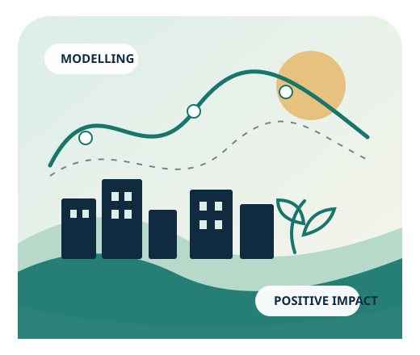
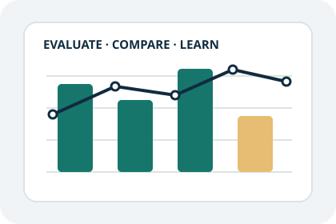

::: {.hero-panel}
::: {.hero-copy}
APPLIED MATHEMATICS · RESEARCH · DATA & AI

# Mathematics first. Research at heart. Technology as a means.

I hold a **PhD in applied mathematics**, with research on reduced-order modelling and environmental dispersion. I am most motivated by understanding complex systems, developing and testing models, and turning rigorous scientific ideas into useful outcomes.

I am particularly interested in applying research and mathematics to projects with **positive environmental, societal, or health impact**. I am technology-agnostic: the problem, the evidence, and the method matter more to me than any particular language, framework, or platform.

[Read about my thesis](https://www.researchgate.net/publication/226478979_Reduced-Order_Modelling_of_Dispersion){.btn .btn-primary .btn-lg} [Explore selected projects](projects.qmd){.btn .btn-outline-primary .btn-lg}
:::
{.hero-illustration fig-alt="Illustration connecting mathematical equations, a city, nature, and scientific research"}
:::

## A research-led, multidisciplinary profile

::: {.grid-cards}
::: {.profile-card}
01

### Mathematics & modelling

Applied mathematics, partial differential equations, reduced-order models, numerical simulation, and the careful examination of assumptions.

[Thesis and scientific publications →](projects.qmd)
:::
::: {.profile-card}
02

### Research & evaluation

Formulate a question, build a method, compare it with meaningful baselines, investigate errors, and communicate what the evidence does—and does not—show.

[TEB-Veg research case study →](projects/teb-urban-modelling.qmd)
:::
::: {.profile-card}
03

### Data science & AI

Five years of Data Science work in a Qlik/Talend lab, spanning statistics, classical ML, LLM evaluation, benchmarking, and experimentation.

[LLM evaluation case study →](projects/llm-hallucination-evaluation.qmd)
:::
:::

## Selected evidence

::: {.evidence-feature}
{.evidence-illustration fig-alt="Stylised illustration of urban hydrology and green infrastructure"}

::: {.evidence-copy}
ENVIRONMENT · SCIENTIFIC MODELLING

### Improving urban hydrological modelling

Co-author of a peer-reviewed study on the hydrological processes in TEB-Veg, part of the SURFEX modelling system. A concrete example of research at the intersection of mathematical modelling, environmental processes, and scientific software.

[Read the 2018 paper](https://gmd.copernicus.org/articles/11/4175/2018/) · [Explore the project](projects/teb-urban-modelling.qmd)
:::
:::

::: {.evidence-feature .evidence-reverse}
{.evidence-illustration fig-alt="Stylised illustration of experimental model evaluation"}

::: {.evidence-copy}
DATA SCIENCE · AI EVALUATION

### Evaluating hallucination detection in LLMs

An industrial benchmark and independent evaluation pipeline comparing approaches to factual-consistency assessment. The public case study focuses on methodology and transferable lessons, respecting confidentiality.

[Read the case study](projects/llm-hallucination-evaluation.qmd)
:::
:::

## What I look for

I am interested in research-oriented and applied-science teams where mathematical reasoning, empirical evaluation, and software can help solve meaningful problems—particularly in **environment, society, and health**. I am open to different technology stacks and domains; I want to choose tools to fit the scientific question, not the reverse.

<small>For my full employment timeline and current details, see [LinkedIn](https://www.linkedin.com/in/brunjm/). This portfolio presents selected evidence rather than claiming equal expertise across every technology encountered.</small>
