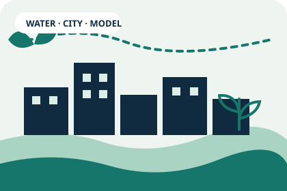

# TEB-Veg: improving urban hydrological modelling

{.project-hero fig-alt="Stylised illustration of an urban environment with water and vegetation"}

::: {.project-meta}
**Research domain:** environmental modelling · urban hydrology · land-surface modelling  
**Publication:** 2018 · *Geoscientific Model Development*  
**Model context:** Town Energy Balance (TEB), integrated in SURFEX
:::

## The question

Urban areas modify exchanges of energy and water with the atmosphere. The representation of rainfall interception, evaporation, and runoff at urban surfaces is relevant to urban climate and impact assessment. The Town Energy Balance (TEB) model represents the urban surface through a simplified street-canyon geometry and parameterises exchanges between roofs, roads, walls, and the atmosphere.

The [CNRM overview of TEB](https://cnrm.sedoo.fr/teb-town-energy-balance/) explains the physical scope and its development within [SURFEX](https://cnrm.sedoo.fr/surfex-2/). These are external descriptions of the model, not claims of authorship of the model as a whole.

## My research contribution

I am a co-author of the peer-reviewed paper:

::: {.citation-panel}
X. Stavropulos-Laffaille, K. Chancibault, **J.-M. Brun**, A. Lemonsu, V. Masson, A. Boone, and H. Andrieu (2018). *Improvements to the hydrological processes of the Town Energy Balance model (TEB-Veg, SURFEX v7.3) for urban modelling and impact assessment*. **Geoscientific Model Development, 11**, 4175–4195.

[Read the paper and abstract](https://gmd.copernicus.org/articles/11/4175/2018/) · [Peer-review discussion](https://gmd.copernicus.org/articles/11/4175/2018/gmd-11-4175-2018-discussion.html)
:::

Further evidence and model resources:

- [Code and run directories associated with the paper (Zenodo)](https://doi.org/10.5281/zenodo.1218016)
- [TEB model source repository](https://github.com/teb-model/teb)
- [CNRM TEB overview](https://cnrm.sedoo.fr/teb-town-energy-balance/)
- [CNRM SURFEX overview](https://cnrm.sedoo.fr/surfex-2/)
- [TEB model documentation](https://teb-model.github.io/teb/)

## Methods and technical themes

::: {.method-grid}
::: {.method-card}
### Mathematical and physical modelling
Represent environmental processes through explicit assumptions and parameterisations.
:::
::: {.method-card}
### Numerical simulation
Integrate process representations into a scientific modelling framework.
:::
::: {.method-card}
### Environmental hydrology
Urban rainfall interception, evaporation, and runoff.
:::
::: {.method-card}
### Scientific software
Fortran-based modelling in the SURFEX/TEB ecosystem.
:::
:::

## Why it matters

This project is applied research at the boundary of mathematics, environmental science, and scientific software. It complements earlier work on reduced-order modelling of atmospheric dispersion and later Data Science and AI evaluation: in each case, the goal is to make a complex system tractable through explicit assumptions, an implementable method, and evidence-based evaluation.

The paper and associated artefacts are the evidence for this work; this page does not claim sole ownership of the model or attribute every component to me individually.
